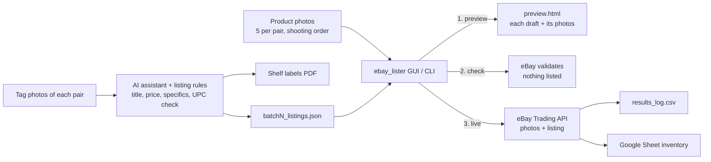

# eBay Shoe Lister

A Python tool that turns a batch of shoe data plus a folder of product photos into live eBay listings, then records each listed pair in a Google Sheet inventory.

I built it at a footwear resale business while preparing a rollout of about 3,500 pairs. Listing by hand meant typing every title and item specific, and matching 5 photos to each pair in eBay's bulk draft tool. This replaced that with one checked, repeatable workflow.

> Screenshots and demo data in this repo use eBay's **sandbox** and made-up products. No real store data is included.

## How it works



1. A lister photographs each shoe's tag. An AI assistant, following a written rule set, builds the listing data: title, price rule (retail − $20, $74.99 floor), item specifics, UPC check digit, shelf location, and a draft number. The output is a batch JSON file and printable shelf labels.
2. A photographer shoots 5 listing photos per pair, in the same order. The script splits the folder into groups of 5, so `photo_group: 3` means photos 11–15.
3. The lister runs the batch through three stages:
   - **Preview:** builds an HTML page showing every draft next to its photos, so a person confirms the photos match before anything is sent.
   - **Check:** eBay's `VerifyAddFixedPriceItem` validates every listing. Nothing is posted and there are no fees.
   - **Live:** after typing `YES`, photos are uploaded and listings are created with `AddFixedPriceItem`.
4. Every result goes to `results_log.csv`, and each posted listing is added to a Google Sheet through a service account.

## Controls built in

The parts I paid the most attention to were the checks that stop a bad listing from going out:

| Risk | Control |
|---|---|
| Wrong photos on a listing | Mandatory preview step; `first_photo` anchor so the script stops if the folder doesn't start where the batch expects |
| Invalid listing data | Check mode validates against eBay before anything goes live |
| Accidental live run | Typed `YES` confirmation; sandbox/production set in config and shown in the window title |
| Listing the same pair twice | Results log skips drafts already listed; a stable per-listing UUID makes eBay reject a duplicate even if a retry happens after a dropped connection |
| Sheet out of sync | Failed sheet writes are saved to a pending file and retried, so a network issue never loses inventory rows |
| Leaked credentials | Keys, service account file and store settings live in git-ignored files; sample templates only |
| Bad UPCs | Check digit verified when the batch is built; unreadable UPCs are left blank and flagged for a rescan, never guessed |

## Project structure

```
ebay_lister.py          core logic: photo grouping, eBay API calls, preview, log
ebay_lister_gui.py      Tkinter window over the same functions (progress bar, stop button, run-N-at-a-time)
inventory_sync.py       writes posted listings to a Google Sheet (gspread), with retry
config.py               loads config.json (store location, policy names, sandbox/production, sheet id)
config.example.json     template for config.json
ebay_keys.example.txt   template for ebay_keys.txt
examples/sample_batch.json   3 made-up listings, including a qty-2 merge and a blank UPC
```

## Running it

Requires Python 3.10+.

```bash
pip install -r requirements.txt
cp config.example.json config.json          # fill in your sandbox policy names + location
cp ebay_keys.example.txt ebay_keys.txt      # sandbox keys + user token from developer.ebay.com
```

Put 20 test photos named `IMG_0001.jpg` … `IMG_0020.jpg` in a folder, then:

```bash
python ebay_lister.py examples/sample_batch.json --photos path/to/photos --mode preview
python ebay_lister.py examples/sample_batch.json --photos path/to/photos --mode check
python ebay_lister.py examples/sample_batch.json --photos path/to/photos --mode live
```

Or run `python ebay_lister_gui.py` and pick the files in the window.

The Google Sheet sync is optional. To use it, create a service account in Google Cloud, enable the Sheets API, share your sheet with the service account email, save the key as `inventory_key.json`, and put the sheet id in `config.json`. Test the connection with `python inventory_sync.py --test`.

## Batch JSON format

Each listing carries its draft number, photo group, eBay fields and item specifics. See [`examples/sample_batch.json`](examples/sample_batch.json). A few rules:

- `photo_group` counts from `first_photo`. A listing with quantity 2+ uses its first pair's group, and the other pairs' groups are skipped so later pairs keep the right photos (draft 102 → 103 in the sample).
- `us_size` is the number only (`"5.5"`, not `"5.5Y"`); eBay rejects the Y. The Y stays in the title and label.
- `price`, `upc` and `category_id` are strings; `quantity` is a number.

## What I'd build next

- **Revise mode:** update quantity and SKU on a listing that's already live, for when an identical pair turns up in a later batch.
- **Photo checks beyond count:** flag extra or missing shots before preview, since one stray photo shifts every group after it.
- **Best Offer and policy rules per price band** read from config instead of fixed values.

## How it was built

I designed the workflow, the rules and the controls, and built the code with AI-assisted development (Claude), testing each stage against real batches before it went into daily use.
